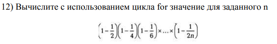
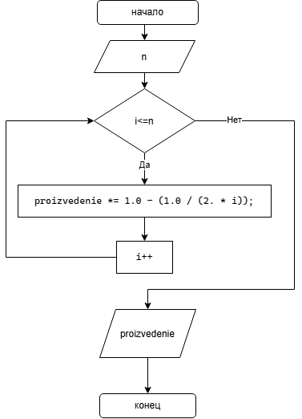

# Домашнее задание к работе 8

## Условие задачи
Вычислите с использованием цикла for значение для заданного n. 



## 1. Алгоритм и блок-схема

### Алгоритм
1. **Начало**
2. Задать исходные данные:
   - `n` - число больше 0
   - `proizvedenie` - произведение всех операций
3. Вычислять пока i<=n:
   - `proizvedenie` *= `1.0 - (1.0 / (2. * i))`
   - `i`++
4. Вывести результат произведения.
5. **Конец**

### Блок-схема



## 2. Реализация программы
```
#define _CRT_SECURE_NO_WARNINGS
#include <stdio.h>
#include <math.h>
#include <locale.h>

int main()
{
	setlocale(LC_ALL,"RUS");
	printf("Введите число n: ");
	double n, proizvedenie = 1.;
	scanf("%lf",&n);
	for (double i = 1.0;i <= n;i++)
	{
		proizvedenie *= 1.0 - (1.0 / (2. * i));
		//printf("(1.0 - %lf) ", 1.0/(2. * i));
		//if (i != n) printf("* ");
	}
	printf("Произведение равно: %.4lf",proizvedenie);
	return 0;
}
```
## 3. Результаты работы программы

Введите число n: 2
Произведение равно: 0,3750

## 4. Информация о разработчике

Ляховский Сергей бИЦТ - 262
